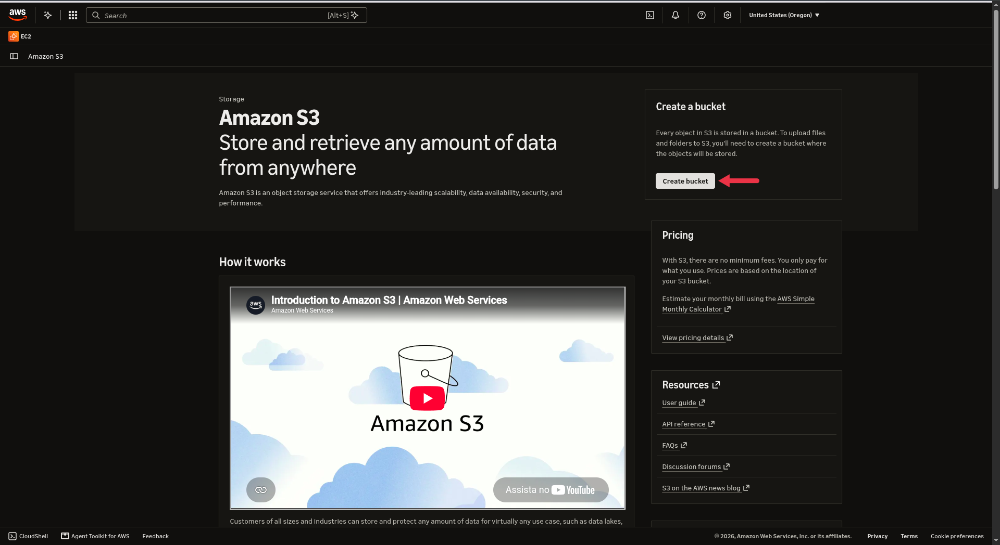

# AWS Training - Laboratório Amazon S3

Este repositório documenta o passo a passo prático da criação, configuração, gerenciamento de objetos e limpeza de buckets no **Amazon S3** durante o treinamento da AWS.

---

## 1. Visão Geral do Amazon S3
Painel inicial do serviço Amazon S3 na console da AWS, onde é possível visualizar a introdução ao serviço e acessar o botão para criar um novo bucket[cite: 1].

---

## 2. Configuração do Bucket (General Configuration)
Definição da região (`us-west-2`), escolha do tipo de bucket (`General purpose`), namespace global e definição do nome do bucket como `lab-s3-davi-1311`[cite: 2].

---

## 3. Configurações de Acesso Público e Versionamento
Configuração de bloqueio de acesso público (`Block all public access` habilitado por segurança) e definição do versionamento de objetos como desativado (`Disable`)[cite: 3].

---

## 4. Status do Upload de Arquivo
Tela de confirmação de sucesso (`Upload succeeded`) indicando que o arquivo `fundo_azul.jpg` foi enviado com sucesso para a raiz do bucket `lab-s3-davi-1311`[cite: 4].

---

## 5. Listagem de Objetos no Bucket
Visualização do bucket `lab-s3-davi-1311` mostrando o objeto `fundo_azul.jpg` armazenado na raiz[cite: 5].

---

## 6. Propriedades e Detalhes do Objeto
Detalhes do arquivo `fundo_azul.jpg`, exibindo o ID do proprietário, região, URL do objeto (`Object URL`) e status do versionamento[cite: 6].

---

## 7. Erro de Acesso Negado (Access Denied)
Tela exibindo uma mensagem de erro em XML (`AccessDenied`), comum ao tentar acessar o link direto de um objeto quando o bucket mantém o bloqueio de acesso público ativado[cite: 7].

---

## 8. Criação de Pasta (Create Folder)
Configuração para criar uma nova pasta chamada `fotos` dentro do bucket `lab-s3-davi-1311`[cite: 8].

---

## 9. Destino do Upload na Pasta
Janela de upload apontando para o caminho de destino interno da pasta criada (`s3://lab-s3-davi-1311/fotos/`)[cite: 9].

---

## 10. Sucesso no Upload para a Pasta
Confirmação do envio bem-sucedido do arquivo para dentro da pasta `fotos/` estruturada no bucket[cite: 10].

---

## 11. Estrutura Atualizada do Bucket
Visualização final da raiz do bucket contendo tanto a pasta `fotos/` quanto o arquivo solto `fundo_azul.jpg`[cite: 11].

---

## 12. Criação de URL Pré-assinada (Presigned URL)
Configuração para gerar uma URL temporária com tempo de expiração customizado (em minutos), permitindo acesso controlado e seguro a um arquivo privado[cite: 12].

---

## 13. Visualização via URL Pré-assinada
Exibição bem-sucedida da imagem `fundo_azul.jpg` aberta no navegador através da URL pré-assinada gerada anteriormente[cite: 13].

---

## 14. Confirmação de Esvaziamento do Bucket (Empty Bucket)
Tela de segurança exigindo a digitação do termo de confirmação (`permanently delete`) para apagar todos os objetos armazenados de uma só vez[cite: 14].

---

## 15. Status de Esvaziamento Concluído
Mensagem de sucesso indicando que os objetos do bucket `lab-s3-davi-1311` foram apagados com êxito[cite: 15].

---

## 16. Exclusão Definitiva do Bucket (Delete Bucket)
Etapa final de encerramento do laboratório, solicitando a confirmação do nome exato do bucket (`lab-s3-davi-1311`) para removê-lo completamente da conta[cite: 16].

---
